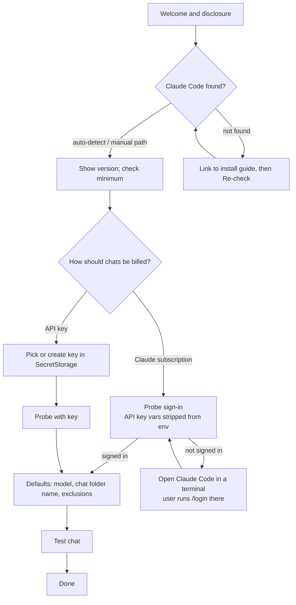
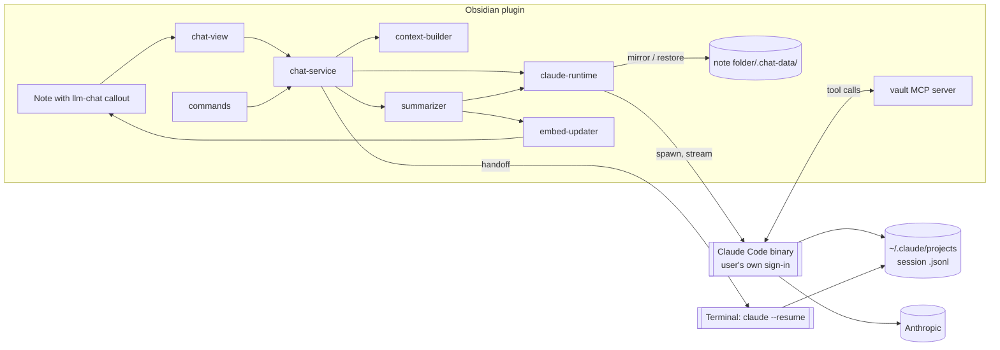
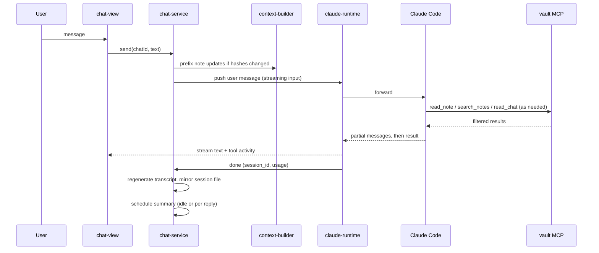

# LLM Sessions for Obsidian — Architecture

Status: **v1.1** (2026-11-24) · Phase 0 spikes done (results in `docs/SPIKES.md`); Phase 1 implemented.

---

## 1. Purpose

Embed **collapsible LLM chat sessions** in Obsidian notes so the user can think in their notes and talk to Claude with little or no context switching. Claude always has the note it lives in, and can pull in earlier chats when it needs them, so it can reason about decisions the user already recorded.

### Goals

- A chat, or one response from it, appears in a note as a **collapsible callout** with a title and an AI summary.
- **Start** a chat from a note, **link** an existing Claude chat, **open and continue** any chat, and **hand off** a chat to Claude Code.
- The host note is always in context. Other chats are **retrievable on demand** based on their summaries, not dumped into the prompt.
- Works with the user's **Claude Pro subscription**.
- Keeps a seam for other LLMs later (§15).

### Non-goals (for now)

- Mobile support (the Agent SDK needs a desktop OS; see §15 for a possible mobile fallback).
- Reading or continuing **claude.ai web chats**. There is still no API for them, so they stay link-only.
- Letting the agent edit notes. The MVP is read-only; editing with approval comes in Phase 3.

---

## 2. Runtime and authentication constraints

### 2.1 How the Agent SDK runs inside Obsidian

- `@anthropic-ai/claude-agent-sdk` drives the **Claude Code CLI as a subprocess**. Obsidian desktop exposes Node APIs (`child_process`, `fs`) to plugins, so this works on desktop only. The manifest sets `isDesktopOnly: true`.
- The SDK normally ships a platform-specific native binary as an optional npm dependency. An Obsidian plugin can release only `main.js`, `manifest.json`, and `styles.css`, so we **cannot ship that binary**. Instead we point the SDK at the user's installed Claude Code with `pathToClaudeCodeExecutable`. This is also what makes subscription use legitimate (§2.2).
- The SDK's JavaScript is bundled into `main.js` by esbuild, with Node built-ins external. *Spike result:* it bundles cleanly and never requires the binary package at load time. It does call `createRequire(import.meta.url)` when it loads, so esbuild defines `import.meta.url` as a real file URL.

### 2.2 Using a Claude Pro subscription

**What the docs say** (Claude Code legal and compliance page, and the Agent SDK overview):

- Allowed: *"an end user signing in to the unmodified Claude Code binary with their own Claude subscription."*
- Not allowed: third-party developers *"offer[ing] Claude.ai login into their own applications"*, routing requests through subscription credentials *"on behalf of their users"*, or *"collect[ing], stor[ing], or intermediat[ing] Claude.ai credentials or session tokens."*
- The SDK overview adds: *"Unless previously approved, Anthropic does not allow third party developers to offer claude.ai login or rate limits for their products, including agents built on the Claude Agent SDK."*
- Pro, Max, and Ultra limits *"assume ordinary, individual usage."*

**How the plugin stays on the allowed side:**

- The plugin **never sees, asks for, stores, or passes on** Claude.ai credentials or OAuth tokens. There is no `setup-token` pasting and no token field.
- The user signs in **in Claude Code itself**, in a terminal. The plugin only launches the user's **unmodified** `claude` binary, which authenticates with its own stored login.
- In subscription mode, the plugin **removes `ANTHROPIC_API_KEY` and `ANTHROPIC_AUTH_TOKEN`** from the subprocess environment. If a key were set system-wide, it would silently take precedence over the subscription login.

**Personal use.** This is the case the docs explicitly allow: you, signed in to the unmodified Claude Code with your own subscription.

**Public community plugin.** This design is the **most defensible one available**, but it is **not guaranteed to be allowed**:

- **For it:** the plugin offers no claude.ai login and never touches credentials. Each user signs in to the unmodified Claude Code themselves, with their own plan. The compliance page says the policy does not prevent *"an end user from signing in to the unmodified Claude Code binary with their own Claude subscription, including where a platform hosts Claude Code,"* and that each end user must authenticate with *"their own Anthropic API key, Claude subscription plan credentials"* or a cloud provider's credentials.
- **Against it:** the SDK overview says that *"unless previously approved,"* third-party developers may not offer *"claude.ai login or rate limits for their products, including agents built on the Claude Agent SDK."* A public plugin whose main job is running Claude Code on a user's subscription limits could be read as offering those limits. Anthropic also says it may enforce *"without prior notice."*

**Plan for release:**
1. Before submitting to the community catalog, **ask Anthropic to confirm** this setup is fine (the "previously approved" route).
2. Word the option as **"Use my Claude Code sign-in,"** never as "Log in with Claude." The plugin has no login screen of its own.
3. Keep **API-key mode** working, so the plugin stays useful if subscription mode ever has to go.
4. Obsidian's review will also look closely at a plugin that starts other programs. The README must disclose that it runs Claude Code, and the manifest must set `isDesktopOnly: true`.

This is Claude's reading of the published policy, not legal advice; confirm with Anthropic before publishing.

### 2.3 What "Claude" means now

| Kind | What it is | Can Obsidian read it? | Can Obsidian continue it? |
|---|---|---|---|
| **Plugin session** | A Claude Code session the plugin created (cwd = the note's folder) | ✅ `getSessionMessages` | ✅ `resume` |
| **Claude Code session** | A session the user started in the terminal or desktop Code tab | ✅ | ✅ (found by ID from any directory, CLI ≥ 2.1.223) |
| **claude.ai web chat** | A conversation on claude.ai | ❌ no API | ❌ link-only; opens in browser or app |

Plugin sessions and Claude Code sessions are **the same thing on disk** (`~/.claude/projects/<encoded-cwd>/<session-id>.jsonl`). Handing off to the terminal is therefore a **true continuation, not a fork** (§11.5).

---

## 3. Concepts

| Term | Meaning |
|---|---|
| **Chat** | The plugin's record of a conversation: plugin ID `c-…`, title, summary, host notes, and a pointer to the underlying session. |
| **Session** | The underlying Claude Code session (UUID), owned by the SDK and CLI. |
| **Message** | A turn in the session, with the SDK's `uuid`. The plugin assigns a short alias (`m7`) used in response embeds and links. |
| **Embed** | A callout in a note that points to a chat (**chat embed**) or one message (**response embed**). |
| **Host note** | The note containing the embed. Always in context. The note a chat was created from is its **home note**. |
| **Chat folder** | The hidden `.chat-data/` folder next to the home note, shared by all notes in that Obsidian folder. |
| **Chat index** | Compact list of related chats (ID, title, one-line summary), given to the agent so it can decide what to retrieve. |
| **Runtime** | The engine that runs sessions. `ClaudeAgentRuntime` now; others later (§15). |

The plugin ID (`c-…`) stays separate from the session UUID. A chat can be re-pointed to a new session (for example, after a fork or a restore) without rewriting every embed.

---

## 4. Onboarding

It runs on first enable and again from **Settings → LLM Sessions → Run setup again**. Nothing is sent anywhere until onboarding finishes.



1. **Welcome and disclosure.** The plugin runs Claude Code on this computer. The current note, plus any notes and chats Claude chooses to read, are sent to Anthropic. Chats count against the user's subscription limits or API billing. Session files live in `~/.claude` and are mirrored into the vault. The user must accept to continue.
2. **Locate Claude Code.** Try PATH (`where claude` on Windows, `which claude` elsewhere) and known install locations (`%USERPROFILE%\.local\bin\claude.exe`, `~/.local/bin/claude`, Homebrew, npm global). Apps launched from the GUI often have a shorter PATH than a terminal, so manual browse is always offered. Run `claude --version` and require **≥ 2.1.223**, the version that can resume a session from any directory.
3. **Choose billing.**
   - **Claude subscription (Pro/Max).** Recommended for personal use. The plugin probes with a tiny query (`maxTurns: 1`, no tools, `persistSession: false`) and the API key variables stripped from the environment. On success it shows the account and plan if the SDK exposes them (*spike*: `apiKeySource` in the init message or an account-info call). If the user is not signed in, **Sign in with Claude Code** opens a terminal running `claude` in the vault folder, and the user runs `/login` there. Then **Re-check**.
   - **Anthropic API key.** Stored in Obsidian SecretStorage (`SecretComponent`) and passed only through the subprocess `env`. Shows cost per chat.
4. **Defaults.** Default model (latest Sonnet), chat folder name (`.chat-data`, or visible `chat-data` for Obsidian Sync users; see §6.3), excluded folders and tags.
5. **Test chat.** One real turn in a throwaway session (not persisted). Then done.

Settings later shows connection status and a **Test connection** button.

---

## 5. User experience

### 5.1 Embeds: native callouts

```markdown
> [!llm-chat|c-01jf8z3k]- Choosing a sleep tracker
> Compared Oura and Whoop for HRV and sleep staging. Chose Oura for no
> subscription lock-in and longer battery life; revisit if HRV accuracy
> disappoints.
>
> [Open chat](obsidian://llm-chat?id=c-01jf8z3k) · 12 messages
```

```markdown
> [!llm-response|c-01jf8z3k#m7]- Choosing a sleep tracker › Battery life comparison
> Oura lasts about 6 days per charge versus about 4 for Whoop; charging habits
> matter more than the spec sheet.
>
> [Open response](obsidian://llm-chat?id=c-01jf8z3k&message=m7)
```

```markdown
> [!llm-chat|c-01jf9q2a]- Meal plan brainstorm
> *Linked claude.ai chat.*
>
> [Open in Claude](https://claude.ai/chat/<uuid>)
```

- Callouts fold natively (`-` means collapsed), still read well without the plugin, are searchable, and their summaries are visible to other chats.
- **Links use the plugin's own URL** (`registerObsidianProtocolHandler('llm-chat', …)`). Transcripts sit in a hidden folder that Obsidian doesn't index, so a wikilink to them would not resolve. The link opens the chat panel, scrolled to the message for response embeds. Without the plugin, the link does nothing, but the title and summary still read fine.
- The plugin keeps its own list of **every note that embeds a chat** (`hostNotes` in the chat record, §6.2), updated when embeds are inserted and when notes are renamed or deleted.
- A post-processor adds actions to rendered callouts: **Continue**, **Continue in Claude Code**, **Copy link**. There is no refresh action; summaries update on their own (§9). It also shows states: *streaming…*, *open in Claude Code*, *chat missing*.

### 5.2 Chat panel

A right-sidebar `ItemView` bound to one chat:

- **Header:** title; labeled **Model** and **Effort** pickers (§7.3); a line saying how the chat is billed; and a labeled **Context** row of chips. The host note is always pinned. Other notes and files can be added and removed: **+** offers the active note, any vault file, or a file from the computer, and dropping files on the panel adds them too. A file from outside the vault is first copied into the attachment folder, because the agent only reads vault files.
- **Messages:** rendered markdown, streamed live. Tool activity is shown compactly (*Read "Sleep"*, *Searched notes for "HRV"*, *Read chat "Oura setup"*). The injected context blocks are collapsed into one line.
- **Per-message actions:** **Embed in note**, **Copy**, **Branch from here** (Phase 3, via `forkSession(upToMessageId)`).
- **Composer:** Send / **Stop** (interrupts the running query).

### 5.3 Commands

Command IDs are stable and must not be renamed after release.

| ID | Name | Behavior |
|---|---|---|
| `new-chat` | Start chat from this note | Inserts a chat embed at the cursor and opens the panel with the host note in context. |
| `open-chat-panel` | Open chat for this note | Opens the chat for the embed under the cursor. Otherwise opens the most recent chat embedded in the active note, or offers to start one. **The active note is always made a context note**, and if it changed since last sent, a note update goes with the next turn (§8.2). |
| `open-chat` | Open existing chat… | Fuzzy picker over chats, listing **this folder's chats first**, then the rest of the vault (title, summary, host notes, last active), plus unlinked Claude Code sessions started in this folder. Choosing one opens the panel and **resumes** the session so the user can keep working. Offers to embed it in the current note. |
| `link-claude-chat` | Link existing Claude chat | Picker of Claude Code sessions (`listSessions`; the note's folder by default, with toggles for the whole vault and all projects) creates a full chat with a summary. **Or** paste a claude.ai URL to create a link-only embed. Either way, inserts the embed at the cursor. |
| `handoff-to-claude` | Continue in Claude Code | Existing chat: opens a terminal running `claude --resume <session>` in the note's folder (same session). New chat: opens Claude Code via deep link with a starter prompt, then auto-links the resulting session (§11.5). |
| `embed-response` | Embed response in note | From the panel: inserts a response embed for the selected message in the host note. |

**Why there is no export import.** Claude Code sessions don't need importing: the SDK lists and reads them directly, so `link-claude-chat` covers them. claude.ai web chats have no API at all. Parsing data-export files was the only way to get their content, and it is clunky and one-way. For those, linking (with an optional pasted summary) is the clean option.

### 5.4 Ribbon

One ribbon icon opens the chat panel. There is no status bar item.

---

## 6. Storage

### 6.1 Layout: a hidden folder next to the note

```
Health/
  Sleep.md
  Supplements.md
  .chat-data/                          ← created by the plugin; shared by Sleep.md and Supplements.md
    c-01jf8z3k.json                    ← chat record (plugin metadata)
    c-01jf8z3k.md                      ← readable transcript (regenerated)
    c-01jf8z3k.session.jsonl           ← mirrored Claude Code session file (opaque backup)
    c-01jg2b7x.json
    …
Health/Running/
  Plan.md
  .chat-data/                          ← separate folder for this subfolder's notes
```

- **One `.chat-data/` per Obsidian folder**, created the first time a note in that folder gets a chat. Every later chat from any note in the folder reuses it.
- A chat's files live in the `.chat-data/` of its **home note** (the note it was created from). **Embedding it in a note in another folder only references it.** That note is added to `hostNotes`, and nothing is created, moved, or copied in the other folder's `.chat-data/`.
- Files are flat and named by chat ID, so renaming a chat or a note never renames files. The title is in the record and in the transcript's heading.
- **Why per folder:** a folder is usually one topic or project. Keeping chats beside their notes keeps them findable in context and gives the agent a natural scope (§8.3). A central folder would mix every topic together.

**Source of truth for the conversation:** the Claude Code session file in `~/.claude/projects/<encoded-cwd>/<uuid>.jsonl`, where the cwd is the home note's folder (§7). It belongs to the CLI. Its format is internal and changes between versions, so **the plugin never parses it**. It reads messages only through `getSessionMessages`.

### 6.2 Files

**Chat record (`.chat-data/<id>.json`):**

```ts
interface ChatRecord {
  id: `c-${string}`;
  sessionId: string;                 // Claude Code session UUID
  sessionCwd: string;                // absolute cwd the session was created in
  runtime: 'claude-agent';
  model?: string;                    // per-chat override (§7.3); unset → settings default
  effort?: Effort;                   // per-chat override
  title: string | null; titleEditedByUser: boolean;
  summary: string | null; summaryStale: boolean;
  homeNote: string;                  // vault path; decides which .chat-data/ holds the files
  hostNotes: string[];               // every note that embeds this chat (vault paths)
  noteHashesSent: Record<string, string>;   // for note updates (§8.2)
  messageAliases: Record<string, string>;   // 'm7' → SDK message uuid
  responseEmbeds: Record<string, { subtitle: string; summary: string }>;
  external?: { app: 'claude-ai'; url: string };   // link-only chats
  inClaudeCode?: { since: string };  // handoff lock (§11.5)
  transcriptPath: string; transcriptHash: string;
  createdAt: string; updatedAt: string;
}
```

**Transcript (`.chat-data/<id>.md`):** generated from `getSessionMessages` after each turn. It is plain markdown with a heading per message (`## m7 · Claude`), so it reads well in any editor, survives uninstalling the plugin, and is what `read_chat` returns to the agent. Obsidian doesn't show it in the vault, so users read chats in the panel. If the file changed since the plugin last wrote it (hash mismatch), the plugin **does not overwrite it**. It offers **Regenerate**, or **Keep my edits** (stop updating this transcript).

### 6.3 Hidden folder: what it means

Obsidian **does not index dot-folders**. That is the point: the files are clearly the plugin's, not the user's. It has consequences the design accounts for:

| Effect | Handling |
|---|---|
| Not shown in the file explorer, search, graph, or Quick Switcher | Intended: no clutter, and other notes and search don't pick up chats. Chats are reached through embeds, the panel, and `open-chat`. |
| `TFile`, `metadataCache`, and wikilinks don't work for these files | All reads and writes go through `vault.adapter` (`read`, `write`, `list`, `exists`, `mkdir`, `rename`). Embeds link with `obsidian://llm-chat`. |
| No backlinks to find embedding notes | `hostNotes` in the record, kept current by the plugin (§11.6). |
| Vault `create`/`rename`/`delete` events don't fire for hidden files | The plugin only reacts to **note** events and moves chat files itself. |
| **Obsidian Sync skips hidden folders** | Setting **Chat folder name**: `.chat-data` (default) or `chat-data` (visible and synced by Obsidian Sync). Onboarding asks which sync the user has. OneDrive, iCloud, Dropbox, and git sync hidden folders normally. *Spike:* confirm current Obsidian Sync behavior. |

### 6.4 Why mirror the session file into the vault

Claude Code session files are **local to the machine** and are **deleted after 30 days** by default (`cleanupPeriodDays`). Without a copy, "open an existing chat and continue" would break for older chats or on another computer. So:

- After each turn, the plugin copies the session file into `.chat-data/<id>.session.jsonl`. It is an opaque copy; the plugin never parses it. Because the vault syncs, the copy reaches the user's other computers.
- **Restore on resume:** if `getSessionInfo(sessionId)` finds nothing locally, the plugin copies the mirror back into `~/.claude/projects/<encoded home-note folder>/` on this machine, then resumes. Resume finds sessions by ID from any directory, so a different vault path on another computer is fine.

**Better option, if it pans out:** the SDK has a `sessionStore` option (alpha in TypeScript) that stores transcripts in a custom backend. If the Phase 0 spike shows it is usable, each folder's `.chat-data/` becomes the **canonical** session store. That would remove both the mirror-and-restore step and any plugin access to `~/.claude`. Until then, mirroring is the safe default.

The `CLAUDE_CONFIG_DIR` setting is **not** used to move sessions into the vault. It would also move Claude Code's login and settings, which would break subscription sign-in.

### 6.5 Index

Hidden folders aren't indexed by Obsidian, so the plugin keeps a small index of its own: `chatId → record path`, plus per-folder chat lists.

- Built lazily after `onLayoutReady`: list the folders that contain notes, check each for a `.chat-data/`, and read only the records (small JSON), never transcripts or session files.
- Cached in the plugin's `data.json` (IDs and paths only, no content) and checked against the folders on load.
- `listSessions` is never called at startup; that happens only in the pickers.

---

## 7. Agent configuration

One `ClaudeAgentRuntime` wraps `query()`. Per chat:

| Option | Value | Why |
|---|---|---|
| `pathToClaudeCodeExecutable` | from onboarding | Uses the user's unmodified binary (§2) |
| `cwd` | **the home note's folder** | Scopes the session to its topic: each folder gets its own Claude Code project, `listSessions({ dir })` returns that folder's sessions, and a handoff opens the terminal right there |
| `env` | `process.env`, minus API key vars (subscription mode) or plus the key (API-key mode) | Avoids the API key silently overriding the subscription login |
| `resume` | the chat's session UUID (after the first turn) | Continue chats |
| `systemPrompt` | custom notes-assistant prompt (stable) | The `claude_code` preset is tuned for coding. *Spike:* compare against the preset with `append` |
| `tools` | **only** our vault MCP tools, plus the subagent tool; built-in Read/Grep/Glob/Bash/Write/Edit/Web tools are removed | Every file access goes through Obsidian-aware tools that enforce exclusions and the vault boundary |
| `mcpServers` | `{ vault: createSdkMcpServer({...}) }` (in-process) | Tools run inside the plugin with Obsidian API access |
| `allowedTools` | the read-only vault tools | Auto-approve reads; anything else goes to `canUseTool` |
| `canUseTool` | Obsidian modal for anything not auto-approved | Note editing (Phase 3) asks for approval with a diff |
| `permissionMode` | `default` (never bypass) | Safety |
| `settingSources` | `[]` by default | Keeps the user's coding hooks, MCP servers, and `CLAUDE.md` out of note chats; a setting can enable the vault's project settings |
| `strictMcpConfig` + `settings: { disableClaudeAiConnectors: true }` | always | *Spike finding:* `settingSources: []` alone still attaches the user's claude.ai connectors (Gmail, Outlook…) from the second turn |
| `verbatimPrompts` | `true` | Note text in user turns must not trigger `@path` expansion or slash commands |
| `agents` | `{ 'chat-historian': … }` | Retrieval subagent (§8.3) |
| `includePartialMessages` | `true` | Live streaming in the panel |
| `model` / `effort` | chat override, else settings (default `sonnet`, effort `medium`) | §7.3 |
| `maxTurns` | 15 | Caps runaway tool loops (per user message in streaming input mode, confirmed by spike) |
| `maxBudgetUsd` | setting (API-key mode only) | Cost guard |
| `abortController` | per query | Stop button, plugin unload |

### 7.1 Vault MCP tools (in-process)

| Tool | Does | Enforces |
|---|---|---|
| `read_note` | Reads a note by path or wikilink, with frontmatter | Vault boundary; exclusions; text only |
| `search_notes` | Full-text and tag search using Obsidian's vault and `metadataCache` | Skips excluded notes **before** results reach the model |
| `get_links` | Outgoing links and backlinks of a note | Exclusions |
| `list_chats` | Searches chat records by title, summary, or host note; `scope: "folder"` (default) or `"vault"` | Reads chat records only |
| `read_chat` | Returns a chat's transcript, or a range of messages | Chats in the vault only; long chats are paginated |

**Why not Claude Code's built-in Grep and Glob?** A Grep result would contain lines from excluded notes before `canUseTool` could filter them. The built-in tools could also reach files outside the vault. Our tools filter first, and they understand wikilinks, aliases, and frontmatter.

**After a handoff to Claude Code**, the in-process tools are gone. The terminal session uses Claude Code's normal tools under the user's own CLI permissions. *Spike:* confirm that resuming in the CLI a session that contains `mcp__vault__*` tool calls works without errors.

**Vault boundary vs. folder scope.** The `cwd` scopes the *session*. The vault tools still allow reading any non-excluded note in the vault, because a note often links to notes in other folders. What is scoped to the folder is the **chat history** the agent sees by default (§8.3).

### 7.2 Process lifecycle

- One live `Query` per **open** chat panel, using streaming input mode (prompt given as an async iterable), so the subprocess stays warm between turns. `startup()` pre-warms it when the panel opens.
- The process closes when the panel closes or after 10 minutes idle. All queries are aborted in `onunload`.
- At most N concurrent processes (default 2). The oldest idle one is closed first.

### 7.3 Model selection

Model choice works at two levels:

| Level | Where | Default |
|---|---|---|
| **Global** | **Settings → Model → Default chat model** | `sonnet` |
| **Per chat** | Model picker in the panel header; saved as `model` / `effort` in the chat record | Unset (uses the global default) |

- **`sonnet` is a Claude Code alias for the latest Sonnet** (currently Claude Sonnet 5.5, `claude-sonnet-5-5`). Using the alias means new Sonnet releases are picked up with no plugin update. Users who want a fixed model can choose a **pinned ID** (`claude-sonnet-5-5`) instead.
- The picker offers the aliases `sonnet`, `opus`, and `haiku`, the matching pinned IDs, and a **Custom…** field for any model ID. If the SDK can list the models available to the signed-in account, the picker uses that list instead (*spike*). Models outside the user's plan fail with a clear message ("Not available on your plan").
- **Effort** follows the same two levels. The default is `medium`, which suits Sonnet 5.5 for chat that uses tools. `low` is a cheaper choice for quick questions.
- **Switching model mid-chat** is allowed: the next turn resumes the same session with the new `model`. The panel notes that the first reply after a switch is slower and uses more of the plan's limits, because the prompt cache is per model and has to be rebuilt.
- The header shows the effective model and where it comes from: *Sonnet · default* or *Opus · this chat*. **Reset to default** clears the override.
- **Summary model** has its own setting, default **`haiku`** (the latest Haiku, currently Claude Haiku 5.5). Summaries are frequent and simple, so the cheapest model fits. Per-chat overrides don't affect it, so changing one chat to Opus doesn't make its summaries cost more.

---

## 8. Context

### 8.1 What goes into a session

1. **System prompt (stable):** who the assistant is (*"You are chatting inside the user's personal notes in Obsidian; they record the user's thinking and decisions…"*), how to use the tools, when to look up earlier chats, and the user's custom instructions.
2. **First user turn:** an `<obsidian-context>` block plus the user's message. The block holds the host note (path, frontmatter, body) and the **chat index** (§8.3).
   - The chat's own callouts are removed from the note to avoid recursion. **Other** chats' callouts stay, since their summaries are useful context.
   - Context goes **in the user turn, not the system prompt**, so it is **saved in the session**. When the chat is resumed in the Claude Code terminal, it still knows the note.
3. **Linked notes:** off by default. The agent can fetch them with `read_note` and `get_links` when relevant, which beats pre-loading them.
4. **Context files** the user added go in the same way as host notes. Notes and text files are text blocks. Images (PNG, JPEG, GIF, WebP; up to 5 MB) and PDFs (up to 20 MB) are attached as image and document content blocks in the user turn, with an `<attachment path="…" />` marker in the text. They are re-sent only when their modified time or size changes.

### 8.2 Keeping the note current

Before each turn, each host note's hash is compared with `noteHashesSent`. If one changed, the next user message is prefixed with `<note-update path="…">…full new content…</note-update>`. The history is never rewritten: Claude sees how the note evolved, and the prompt cache stays valid. The panel shows *"Sleep updated — will be sent with your next message."*

When a chat is opened from a different note (`open-chat-panel` or `open-chat`), that note becomes an additional host note and is sent the same way.

### 8.3 Chat history: summaries first, retrieval on demand

- The **chat index** in the first turn lists **only chats from the same folder** (the home note's `.chat-data/`), plus any chat embedded in the host note itself. Each entry has ID, title, one-line summary, and date. At most about 20 entries, most recent first; full transcripts are **never** included.
- **Same folder by default.** `list_chats` and the `chat-historian` subagent search the current folder unless the user's request clearly needs more ("across all my notes…"). In that case they can pass `scope: "vault"`, and the panel shows it (*Searched chats across vault*). A setting can turn vault-wide search off entirely.
- The agent decides from the summaries whether to look deeper:
  - `read_chat` for a quick look at one chat.
  - The **`chat-historian` subagent** for anything broad ("what did I decide about supplements across my chats?"). It searches and reads transcripts **in its own context** with `list_chats` and `read_chat`, and returns only the relevant excerpts with chat IDs. The main conversation stays lean, which is the right job for a subagent.
- The panel shows retrievals as tool activity (*Read chat "Oura setup"*).

---

## 9. Summaries

**Approach: one-shot, unsaved query over the visible conversation.** It is not a subagent, and it does not resume or fork the session.

```ts
query({
  prompt: summaryPrompt(conversationForSummary(turns)),  // "User: … / Assistant: …", note blocks removed
  options: {
    persistSession: false,           // leaves no session file behind
    tools: [], maxTurns: 3,          // structured output can take an extra turn
    outputFormat: { type: 'json_schema', schema: SummarySchema },   // { title?, summary? }
    model: settings.summaryModel,    // default 'haiku'
    effort: 'low',
    // same executable and env as the chat (baseOptions)
  },
});
```

**Why not fork the session?** The first design resumed the session as an unsaved fork (`forkSession` + `persistSession: false` + `outputFormat`; the spike showed this works). In use, the summaries described the **note**: the session's first user turn carries the note in an `<obsidian-context>` block, so the fork saw it as part of "the conversation." The summary now comes from the turns returned by `getSessionMessages`, with every `<obsidian-context>`, `<note>` and `<note-update>` block removed and tool activity left out (`core/summary-input.ts`). The model never sees the note. It also sends far fewer tokens than resuming the whole session. Long chats keep their newest messages (about 40k characters).

**Why not a subagent?** A subagent runs **inside** the main session. Its call and result would be written into the transcript the user reads, and continued in Claude Code, on every update.

- **Chat summary:** the title is generated once, after the first reply (unless the user set one). The summary is at most 2 sentences, and always shorter than the conversation. It mentions decisions or open questions only when there are some.
- **Short chats:** when a chat is a single exchange and the reply is short (up to 400 characters and 8 lines), the callout shows the reply itself instead of a summary, because any summary would be longer than the chat. The title is still generated.
- **AI label:** rendered chat callouts and the chat panel show "can contain mistakes" labels. The plugin draws them; they are not written into the note.
- **Summary version:** `SUMMARY_VERSION` in `chat-service.ts` is part of the "changed since last summary" key. A summary whose key no longer matches (the chat changed, or `SUMMARY_VERSION` was bumped) is rewritten when the user sees it: when its callout is drawn in a note or the chat opens in the panel. Refreshes run one at a time and each chat state is tried once per session, so a failing summary cannot retry on every redraw.
- **Response summary:** when a response is embedded, the same approach is asked for `{ subtitle, summary }` of that message.
- **When:** **when idle**: 2 minutes after the last reply, or when the panel closes, whichever comes first. A summary runs only if the chat changed since the last one. This keeps summary calls to about one per working session instead of one per reply, which matters because they use the same subscription limits as chatting.
- **Inserting a callout:** a new callout always gets a blank line before and after it, and the cursor moves to a line below that blank line (`embed/callout-insert.ts`). In Markdown, a line typed directly under a quote block continues the quote, so without the blank line the user's next words would join the callout.
- **Applying:** `embed-updater` rewrites matching callouts in every note listed in `hostNotes` with `vault.process`, touching only callouts whose metadata matches the chat. A callout it cannot parse is left alone and marked stale.
- There is no manual refresh command, by design.

---

## 10. Component architecture

### 10.1 Module layout

```
src/
  main.ts                         # lifecycle: settings, views, commands, processors, onboarding trigger
  types.ts
  settings/
    settings.ts                   # interface, defaults, versioned migration
    settings-tab.ts
  onboarding/
    onboarding-modal.ts           # multi-step flow (§4)
    claude-code-locator.ts        # PATH + known locations + version check
    auth-probe.ts                 # probe query, env stripping
  runtime/
    runtime.ts                    # AgentRuntime interface (provider seam, §15)
    claude/
      claude-runtime.ts           # query() wrapper, streaming input, lifecycle pool
      claude-options.ts           # builds Options from settings + chat
      summarizer.ts               # forked one-shot summaries (§9)
      session-mirror.ts           # mirror + restore session files (§6.2)
  tools/
    vault-mcp-server.ts           # createSdkMcpServer + tool() definitions
    vault-access.ts               # exclusions, vault boundary, note reading/search via Obsidian API
    chat-historian.ts             # subagent definition
  core/
    chat-folders.ts               # resolve/create <note folder>/.chat-data via vault.adapter
    chat-store.ts                 # record/transcript/mirror read & write (adapter only)
    chat-index.ts                 # plugin-maintained index (hidden folders aren't indexed)
    note-lifecycle.ts             # note rename/move/delete → move chat files, update hostNotes
    protocol-handler.ts           # obsidian://llm-chat?id=&message=
    chat-service.ts               # orchestration: create, send, resume, link, handoff
    context-builder.ts            # obsidian-context block, note updates, chat index
    transcript-writer.ts          # getSessionMessages → markdown
  embed/
    callout-format.ts             # parse/serialize callouts (pure, unit-tested)
    embed-postprocessor.ts        # actions + states on rendered callouts
    embed-updater.ts              # rewrite callouts across embedding notes
  handoff/
    terminal-launcher.ts          # per-OS: open terminal with `claude --resume`
    deep-links.ts                 # claude-cli://open?cwd=&q= ; claude.ai URL parsing
    session-watcher.ts            # find the session a deep link created
  ui/
    chat-view.ts                  # side panel ItemView
    message-renderer.ts           # throttled MarkdownRenderer streaming
    chat-picker.ts                # SuggestModal for open-chat / link-claude-chat
    tool-approval-modal.ts        # canUseTool UI (Phase 3 edits)
  commands/
    index.ts
  utils/
```

### 10.2 Component diagram



---

## 11. Key flows

### 11.1 New chat

1. `new-chat` finds or creates `.chat-data/` in the note's folder, writes a `ChatRecord` there (no session yet, `homeNote` = this note), and inserts `> [!llm-chat|c-…]- New chat` at the cursor.
2. The panel opens with the host note pinned. When the user sends the first message, `context-builder` adds the `<obsidian-context>` block and the runtime starts a query with `cwd` = the note's folder.
3. The init message provides `session_id`, which is stored in the record.

### 11.2 Send a turn



### 11.3 Open an existing chat and continue

1. `open-chat` → picker, or **Continue** on a callout.
2. `getSessionInfo(sessionId)`. If the session is missing locally, restore it from `.chat-data/<id>.session.jsonl` (§6.4).
3. If the chat is marked *open in Claude Code*, ask: *"Continue here instead? Close the terminal session first to avoid two writers."*
4. Re-render the transcript from `getSessionMessages` (it picks up any turns added in the terminal), open the panel, add the active note as a host note, and start a query with `resume`.

### 11.4 Link an existing chat

- **Claude Code session:** picker from `listSessions({ dir: noteFolder })`, with toggles for the whole vault and all projects. It shows `customTitle`, `summary`, `firstPrompt`, and `lastModified`. Linking creates a `ChatRecord` in the current note's `.chat-data/` pointing at that session, mirrors the file, generates a summary, and inserts the embed. The session keeps its original cwd (`sessionCwd`); resume finds it by ID.
- **claude.ai URL:** creates a link-only record (`external.url`) with a user-provided title and an optional pasted summary.

### 11.5 Hand off to Claude Code

- **Existing chat (same session, no fork).** `terminal-launcher` opens the user's terminal in the home note's folder running `claude --resume <sessionId>`:
  - Windows: Windows Terminal (`wt -d <folder> …`), falling back to PowerShell.
  - macOS: Terminal or iTerm via `open`/AppleScript.
  - Linux: `$TERMINAL`.

  The chat is marked `inClaudeCode` and the panel composer is disabled, so two writers never append at once. **Return to Obsidian** (or reopening the chat) clears the mark and re-renders the transcript. SDK-created sessions don't appear in the CLI's session picker, but resuming by ID is supported.
- **New chat started in Claude Code.** Opens `claude-cli://open?cwd=<note folder>&q=<prompt>` (5,000 characters max; the user presses Enter to send). The prompt is short and **refers to the note by file name** instead of pasting it, since Claude Code starts in that folder and can read it. It also carries a marker (`[obsidian-chat c-…]`). `session-watcher` polls `listSessions({ dir: noteFolder })` for a few minutes for a session whose `firstPrompt` contains the marker, then links it. Requirement: the `claude-cli://` handler registers only after the user has sent at least one message in interactive Claude Code; onboarding can do this.
- **Later (Phase 3):** **Send to Claude app** opens `claude://claude.ai/new?q=…` (about 14k characters) as a **fork** into a claude.ai chat, for users who prefer the app.

### 11.6 Notes renamed, moved, or deleted

`note-lifecycle` listens to the vault's `rename` and `delete` events for notes. It does not need events for the hidden files.

| Event | What happens |
|---|---|
| **Rename within the same folder** | Update `homeNote` and `hostNotes` in the affected records. Chat files don't move; they are named by ID. |
| **Move to another folder** | For chats whose **home note** moved: create the target folder's `.chat-data/` if needed and move the record, transcript, and mirror there (`adapter.rename`). Update paths and the index. For chats only embedded there, just update `hostNotes`. |
| **Delete** | Remove the note from `hostNotes`. If it was the home note, the chat stays in place as an **orphan**. It still appears in `open-chat` (marked *note deleted*) and can be embedded in other notes, which reference it where it is. Chat data is never deleted automatically. |
| **Empty `.chat-data/`** after a move | Removed only if it contains no files at all. |

The Claude Code session itself never moves: `sessionCwd` keeps its original folder, and resuming by ID works from anywhere. A handoff after a move opens the terminal in the note's **new** folder.

---

## 12. Settings

| Group | Setting | Default |
|---|---|---|
| **Connection** | Claude Code path | Auto-detected |
| | Billing | Claude subscription / API key (chosen in onboarding) |
| | API key | SecretStorage (API-key mode only) |
| | Test connection · Run setup again | — |
| **Model** | Default chat model | `sonnet` (latest Sonnet); aliases, pinned IDs, or custom. Overridable per chat (§7.3) |
| | Default effort | Medium (overridable per chat) |
| | Summary model | `haiku` (latest Haiku) |
| | Custom instructions | Empty |
| **Agent** | Allow web search/fetch | Off |
| | Allow note editing (with approval) | Off (Phase 3) |
| | Load vault's Claude Code project settings | Off |
| | Max tool turns per message | 15 |
| | Spending cap per message | API-key mode only |
| **Context** | Include chat index (same folder) | On |
| | Allow vault-wide chat search | On (agent asks only when the request needs it) |
| | Excluded folders / tags | Empty |
| | Per-note opt-out key | `llm-context` |
| **Chats** | Chat folder name | `.chat-data` (hidden), or `chat-data` (visible, for Obsidian Sync); created next to each note |
| | Mirror session files into vault | On |
| | Summary idle delay | 2 minutes (also runs when the panel closes) |
| | Summary length | Short |
| **Embeds** | Collapsed by default | On |
| **Handoff** | Terminal app | Auto (Windows Terminal → PowerShell) |

`minAppVersion: 1.11.4` (SecretStorage) and `isDesktopOnly: true`.

---

## 13. Privacy, security, and policy

- **Explicit opt-in** through onboarding. The README discloses everything: that the plugin spawns Claude Code, what is sent to Anthropic, the session files in `~/.claude`, and the hidden `.chat-data/` folders it creates next to notes.
- **Hidden doesn't mean private.** `.chat-data/` is hidden from Obsidian, but it is ordinary files that OneDrive (or any sync tool) uploads. The README says so plainly.
- **Credentials.** The plugin never handles Claude.ai credentials (§2.2). An API key, if used, lives in SecretStorage, not in `data.json`, which syncs to OneDrive with the vault.
- **Vault boundary.** The agent reaches notes only through the vault MCP tools, which reject paths outside the vault and excluded notes. The plugin itself touches `~/.claude` only for mirror and restore. If the `sessionStore` spike succeeds, that access goes away.
- **Least context.** Host note plus the chat index by default. The agent may read more notes on its own, which the panel shows as tool activity and the onboarding disclosure states plainly.
- **Prompt injection.** Notes can contain clipped web text, and the agent now has read tools. The exfiltration risk comes from web tools (data hidden in a URL), so they are **off by default** and enabling them shows a warning. Note editing (Phase 3) always requires explicit approval with a diff.
- **Isolation from the user's coding setup.** `settingSources: []` keeps the user's global hooks, MCP servers, and permissions out of note chats unless opted in.
- **No telemetry, no remote code.** Output is rendered with `MarkdownRenderer` and never evaluated.

---

## 14. Platform and performance

- **Desktop only.** Windows needs care with paths that contain spaces (this vault: `OneDrive\Personal Health`). Deep-link `cwd` must be a local absolute path; network and UNC paths are rejected.
- **Startup:** register only; the onboarding check is cheap (it reads a settings flag). No subprocess spawns until a chat is used.
- **Streaming render** is throttled to about 50 ms.
- **Cleanup:** `register*` helpers everywhere; all subprocesses are killed in `onunload`.
- **Sync conflicts:** one record and one mirror per chat. A conflicted record is kept as `*.conflict.json` and never deleted.

---

## 15. Other LLMs later

The Agent SDK is Claude-only, so the seam is an `AgentRuntime` interface:

```ts
interface AgentRuntime {
  id: 'claude-agent' | string;
  start(chat: ChatRecord, firstMessage: UserTurn): AsyncIterable<RuntimeEvent>;
  send(chat: ChatRecord, message: UserTurn): AsyncIterable<RuntimeEvent>;
  readMessages(chat: ChatRecord): Promise<NeutralMessage[]>;
  summarize<T>(chat: ChatRecord, schema: JSONSchema, prompt: string): Promise<T>;
  listExternalSessions?(): Promise<ExternalSessionInfo[]>;
  handoff?(chat: ChatRecord): Promise<void>;
}
```

- Vault tools are defined once (name, zod schema, handler). Each runtime adapts them: an MCP server for Claude, function tools for OpenAI or Gemini.
- Plugin metadata, embeds, transcripts, and context building are runtime-neutral. Only the session payload is runtime-specific.
- A **Messages-API runtime** (calling the Claude API directly with an API key, no Claude Code) could later provide **mobile** support with an API key, reading mirrored transcripts and starting new sessions on mobile.

---

## 16. Roadmap

| Phase | Scope |
|---|---|
| **0. Spikes** | (a) Bundle the SDK with esbuild and run the user's `claude` on Windows and macOS from Obsidian. (b) Subscription probe and env stripping; what auth info the SDK exposes. (c) Streaming input mode and process lifecycle. (d) `sessionStore` viability. (e) `forkSession` + `persistSession: false` + `outputFormat` for summaries. (f) Resuming in the CLI a session that contains in-process MCP tool calls. (g) Callout `\|metadata` plus the post-processor in Live Preview. (h) Launching a terminal with `claude --resume` on Windows. (i) `vault.adapter` read/write/rename in `.chat-data/` folders; `obsidian://llm-chat` handler; Obsidian Sync behavior for hidden folders. (j) Whether the SDK exposes the account's available models for the picker. |
| **1. MVP** | Onboarding (subscription + API key), `new-chat`, chat panel with streaming, global and per-chat model, host-note context and note updates, vault MCP tools (`read_note`, `search_notes`, `get_links`), chat embeds with auto title and summary, per-folder `.chat-data/` with transcripts and mirroring, note rename/move handling, `open-chat` (continue, with restore). |
| **2. History and handoff** | `open-chat-panel`, `embed-response`, `link-claude-chat` (Claude Code sessions + claude.ai links), `handoff-to-claude` (resume in terminal; new chat via deep link), chat index, `list_chats` / `read_chat`, `chat-historian` subagent. |
| **3. Power features** | Note editing with approval, Branch from here, Send to Claude app, optional web tools, `sessionStore` migration if viable. |
| **4. More runtimes** | Messages-API runtime (mobile), then OpenAI and Gemini. |

---

## 17. Open questions

None open. Decisions so far:

| Topic | Decision |
|---|---|
| Distribution | Personal use now; community release later, after Anthropic confirms (§2.2) |
| Billing | User's own Claude Code sign-in (subscription) or API key; the plugin never handles login details |
| Chat storage | Hidden `.chat-data/` next to each note, one per folder (§6) |
| Chats embedded in another folder | Referenced in place; nothing moved or copied (§6.1) |
| Chat model | Latest Sonnet (`sonnet`) by default; configurable globally and per chat (§7.3) |
| Summaries | Haiku (`haiku`), run when idle (§9) |
| Vault Claude Code settings / `CLAUDE.md` | Not loaded by default (`settingSources: []`), opt-in setting (§7) |
| Chat history scope | Current folder first; agent widens to the vault only when the request needs it (§8.3) |

## 18. Risks

| Risk | Mitigation |
|---|---|
| Anthropic's subscription policy changes, or it is enforced against this use | Credentials never handled; unmodified binary only; API-key mode always available. |
| SDK can't be bundled or can't run in Obsidian's Electron renderer | Phase 0 spike first. Fallback: spawn the `claude` CLI directly in `-p --output-format stream-json` mode behind the same `AgentRuntime` interface. |
| Session file format or location changes between Claude Code versions | Never parse it; use SDK functions only; mirror is an opaque copy; minimum version checked in onboarding. |
| Two writers (panel + terminal) on one session | `inClaudeCode` lock, disabled composer, re-render on return. |
| Claude Code's 30-day cleanup deletes old sessions | Vault mirror + restore; or `sessionStore`. |
| Subscription limits hit by chat + summaries | Idle-based summaries; summary model setting; clear rate-limit messaging. |
| Obsidian Sync users lose chats on other devices (hidden folders not synced) | Onboarding asks about sync; visible `chat-data` option. |
| Notes moved outside Obsidian (file manager, sync tool) leave chats behind | On load, check that each record's home note still exists; offer to re-home orphans found by matching callout IDs in notes. |
| `sonnet` alias jumps to a new model with different behavior | Shown in the header; pinned IDs available for users who want stability. |
| Deep-link handler not registered | Detect failure; fall back to opening a terminal with `claude` and copying the prompt to the clipboard. |
